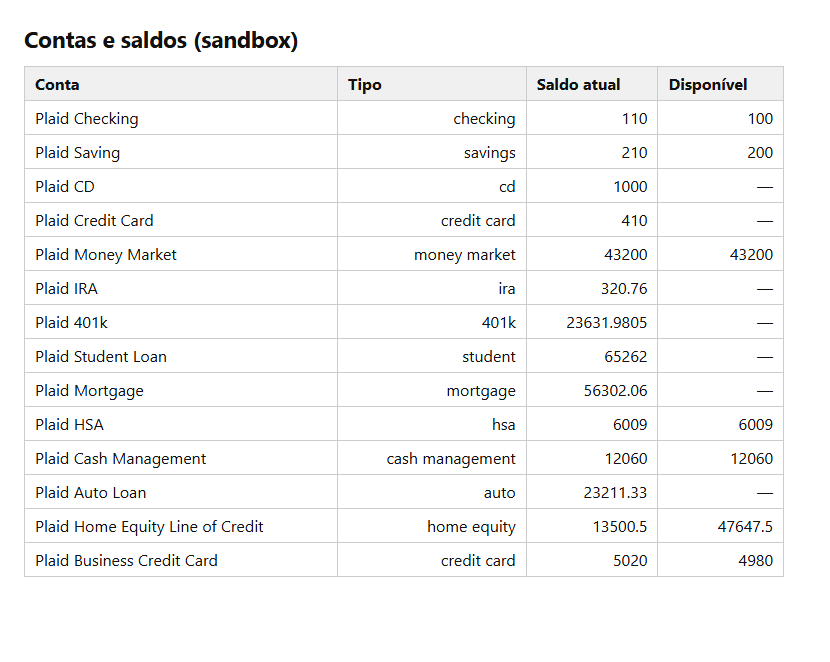
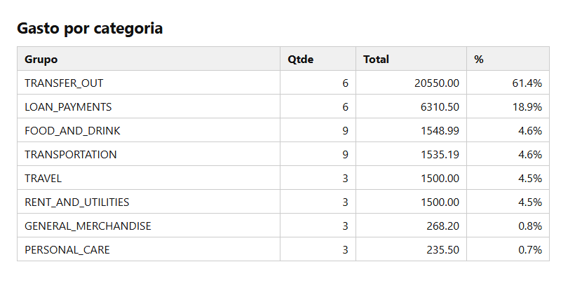
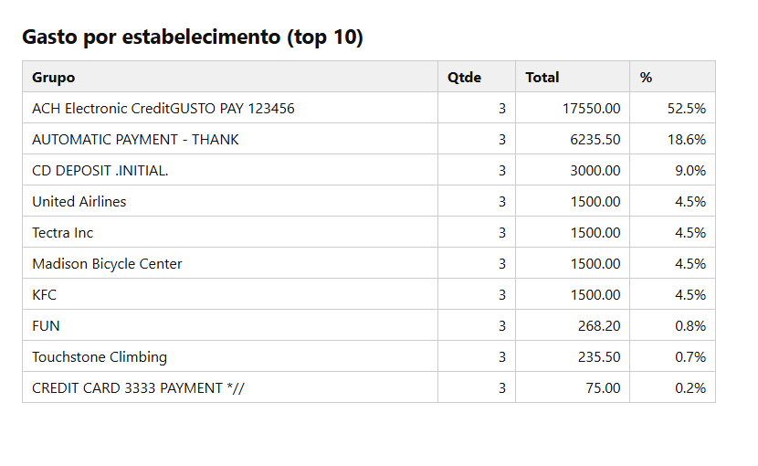
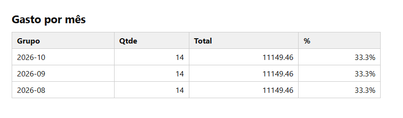
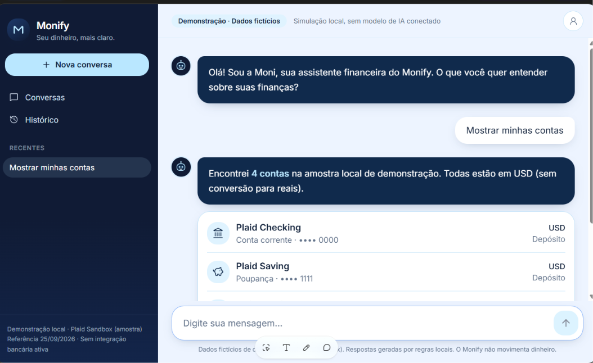
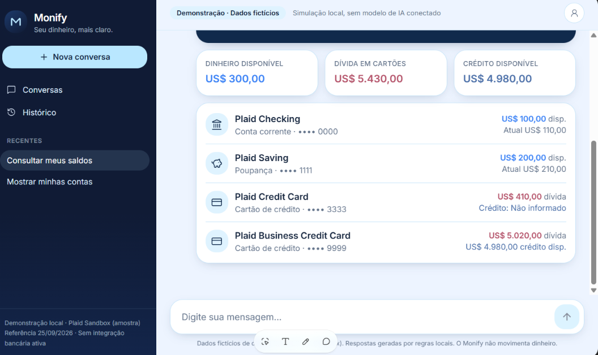

# Agente Financeiro com MCP


Assistente financeiro em formato de chat (**Monify / Moni**). Responde
sobre um banco de teste usando MCP. **Todos os dados são fictícios.**

**App publicado:** <https://moni-money-mosaic.lovable.app>

## 1. Onde o cliente está e o que o assistente responde

O cliente está dentro de um **app de banco**: abre o chat e pergunta em
linguagem simples, sem entrar em menus.

| Pergunta | Resposta | Origem do dado |
|----|----|----|
| “Mostrar minhas contas” | Lista de contas (corrente, poupança, cartões) com tipo e final | Plaid Sandbox (`accounts`) |
| “Consultar meus saldos” | Dinheiro disponível, dívida em cartões, crédito disponível, saldo atual e disponível por conta | Plaid Sandbox (`balances`) |
| Gasto por categoria, estabelecimento e mês | Tabelas com quantidade, total e % | Plaid Sandbox (`transactions`) |
| O que é um Item, como integrar no Brasil | Explicação com fontes | Documentação da Pluggy via MCP |

Valores em **USD**, sem conversão para reais. Na Plaid, valor positivo é
saída. O app avisa na tela: *“Demonstração · Dados fictícios”*.

**Limite atual:** o app publicado responde por **regras locais sobre uma
amostra do Plaid Sandbox** (aviso no rodapé: “Respostas geradas por
regras locais”). Não chama a Plaid nem a Pluggy em tempo real. A
consulta via MCP foi feita na IA (seção 2), e as tabelas abaixo são o
resultado.

### Evidências: tabelas na IA (Plaid Sandbox via MCP)

|  |  |
|----|----|
|  |  |
|  |  |

### Evidências: conversa no app

|  |  |
|----|----|
|  |  |

## 2. Configuração dos servidores MCP

Arquivo [`.mcp.json`](.mcp.json):

``` json
{
  "mcpServers": {
    "pluggy": {
      "type": "http",
      "url": "https://mcp.pluggy.ai/mcp"
    },
    "plaid": {
      "type": "stdio",
      "command": "<caminho-do-uvx>",
      "args": ["--env-file", ".env", "mcp-server-plaid"]
    }
  }
}
```

**Pluggy (Streamable HTTP, sem chave)**

1.  Adicione o servidor com a URL `https://mcp.pluggy.ai/mcp`.
2.  Confira com `/mcp`.
3.  Peça à IA que explique o que é um Item, com as fontes.

**Plaid (STDIO)**

1.  Em Developers → Keys, copie o Client ID e o secret de **Sandbox**.

2.  Instale o [`uv`](https://docs.astral.sh/uv/) e descubra o caminho do
    `uvx`.

3.  Crie `.env` (nunca versionado, está no `.gitignore`):

        PLAID_CLIENT_ID=<seu-client-id>
        PLAID_SECRET=<seu-secret-sandbox>
        PLAID_ENV=sandbox

4.  Ajuste `command` no `.mcp.json` para o caminho do seu `uvx`. No
    Windows é algo como `...\Python313\Scripts\uvx.exe`.

5.  Reinicie a IA, crie um Item de teste e leia contas, saldos e
    transações.

A Plaid é só um laboratório. Não representa o Open Finance brasileiro,
que em produção exige consentimento e segurança.

## 3. Especificação enviada ao Lovable e ajustes

**Especificação:** web app em formato de chat, marca Monify, assistente
“Moni”, que responde sobre um banco de teste. Telas: barra lateral (nova
conversa, conversas, histórico), área de chat com cartões de resumo e
lista de contas, campo de mensagem e aviso fixo de dados fictícios.
Prompt enviado no modo chat primeiro, para tirar dúvidas, e depois
publicado.

**Ajustes depois da primeira versão:**

- Aviso de dados fictícios visível no topo e no rodapé.
- Valores declarados em USD, sem conversão silenciosa.
- Cartão de crédito mostra *dívida* e *crédito disponível*, não “saldo”.
- Chaves ficam fora do app: o front usa uma amostra local e não guarda
  segredo.

## 4. Melhoria escolhida e endereço do app

**Melhoria:** novas perguntas além de “contas”, com **saldos
consolidados** (dinheiro disponível, dívida em cartões, crédito
disponível) e valores declarados em USD.

**Próximo passo:** backend com as chaves só no servidor (Etapa 2), para
o chat consultar a Plaid e a Pluggy em tempo real em vez de usar a
amostra.

**App funcional:** <https://moni-money-mosaic.lovable.app>
